

  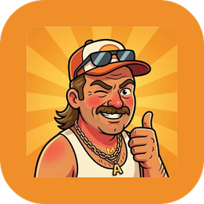

<h1 align="center">🎪 La Ligue des Beaufs</h1>

  <b>Une arcade de mini-jeux de réflexes et de timing pour Android, avec la famille la plus beauf de France.</b> 
  <i>An Android arcade of reflex and timing mini-games, starring France's most "beauf" family.</i>

   
  <b>Bientôt disponible sur Google Play</b> · actuellement en test

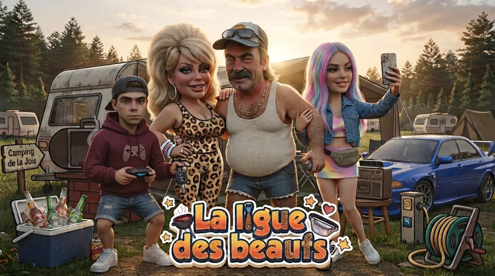

Bienvenue au camping ! Patrick, Sandrine, Cindy et Kévin Merguez ont chacun leur jeu, et ils
comptent bien te montrer qui est le meilleur. Joue en solo pour battre ton record et grimper au
classement mondial, à plusieurs sur le même téléphone, ou **en ligne contre tes potes**.

  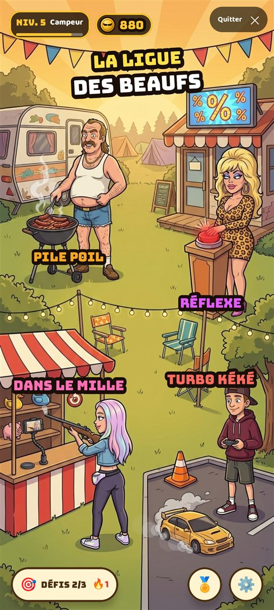 
  Le camping : un jeu par membre de la famille, la boutique, la vitrine et les défis du jour

## 🎮 Les jeux

### ⏱️ Pile Poil — Patrick, le père

> *Le roi du timing (surtout quand il se trompe).*

L'ardoise du barbecue annonce un temps de cuisson : retiens-le, le couvercle se ferme, et soulève-le
**pile poil** au bon moment. Trop tôt, c'est cru. Trop tard, c'est cramé.

<table>
<tr>
<td align="center">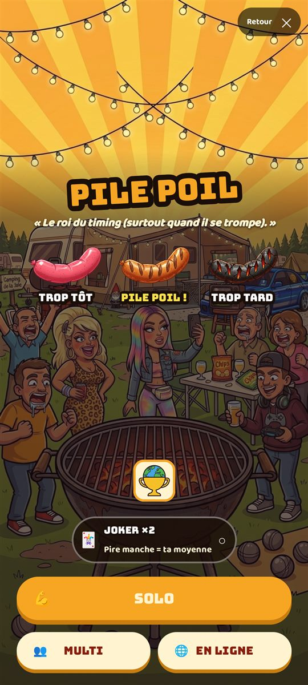 Accueil</td>
<td align="center">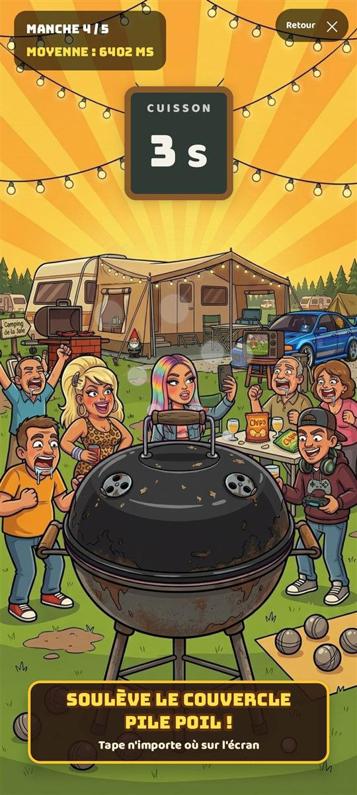 En cuisson</td>
<td align="center">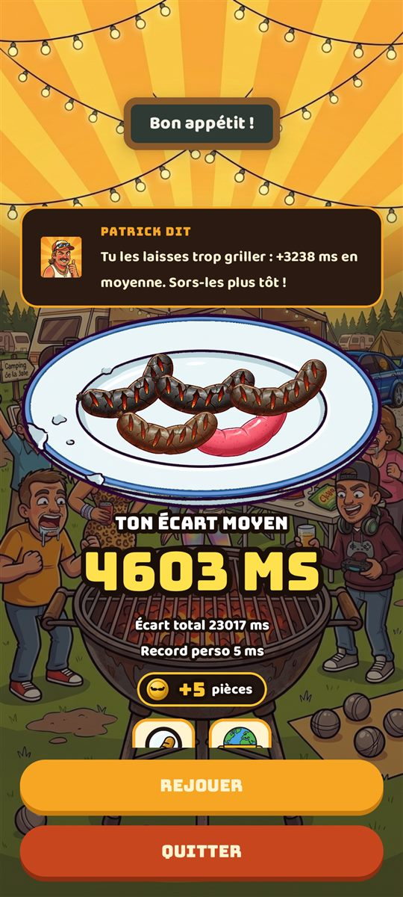 L'assiette des résultats</td>
</tr>
</table>

### 🛍️ Réflexe de Beauf — Sandrine, la mère

> *Si ça clignote, elle clique.*

Le magasin va ouvrir : buzze dès que « PROMO ! » s'affiche. Un buzz trop tôt coûte cher, et les
résultats sortent sur un vrai ticket de caisse.

<table>
<tr>
<td align="center">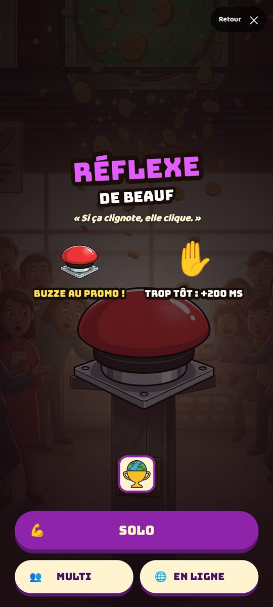 Accueil</td>
<td align="center">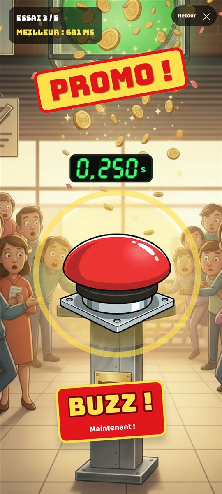 PROMO ! Buzz !</td>
<td align="center">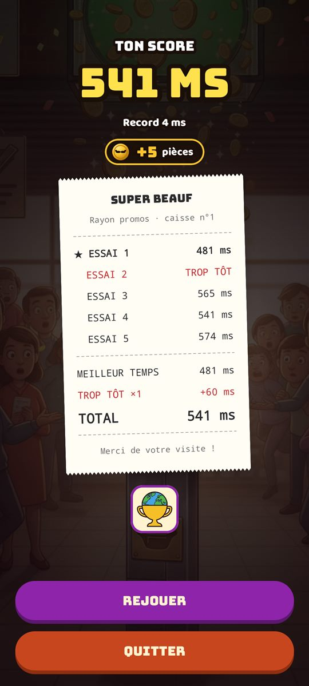 Le ticket de caisse</td>
</tr>
</table>

### 💖 Dans le Mille, Peuchère ! — Cindy, la fille

> *Le selfie parfait ou rien.*

Le stand de tir de la fête foraine, filmé en live pour les réseaux de Cindy : touche les cibles et le
canard d'or, enchaîne les combos, évite les photobombs de Kévin. Mieux tu vises, plus beau est le lot.

<table>
<tr>
<td align="center">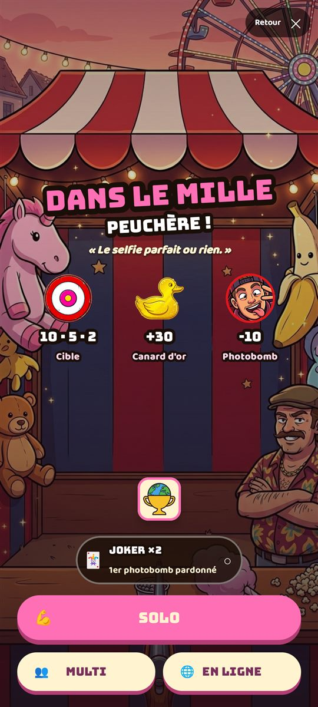 Accueil</td>
<td align="center">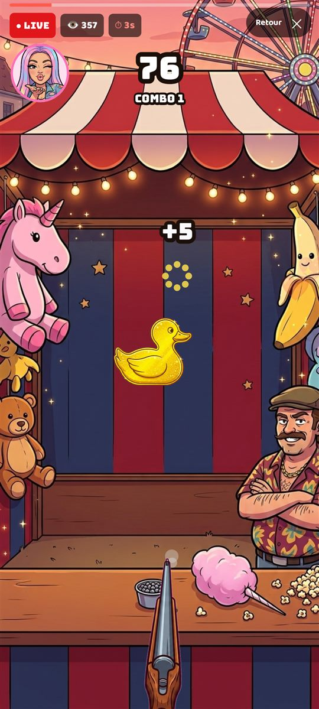 En live</td>
<td align="center">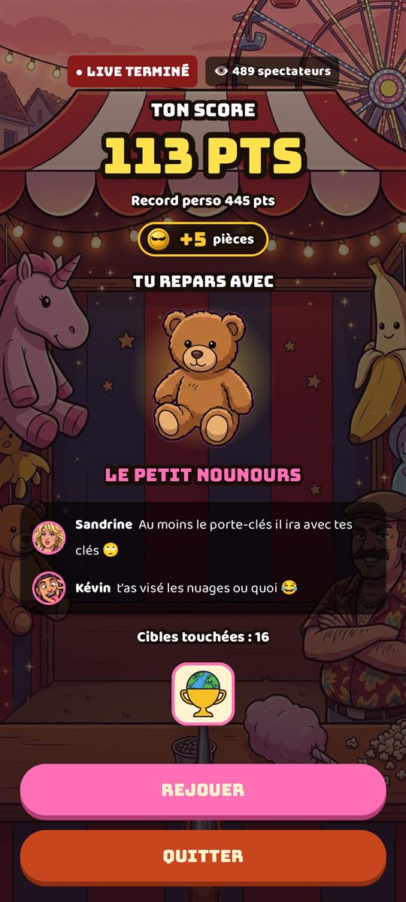 Le lot remporté</td>
</tr>
</table>

### 🏎️ Turbo Kéké — Kévin, le fils

> *Le permis attendra, le drift non.*

Maintiens le doigt pour faire déraper la voiture téléguidée autour du cône du parking. Plus le drift
est serré et long, plus le combo grimpe… gare au mur !

<table>
<tr>
<td align="center">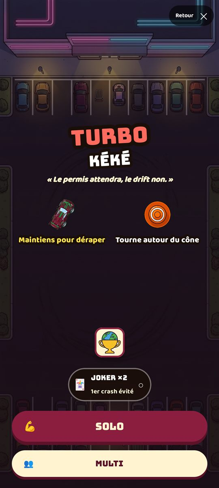 Accueil</td>
<td align="center">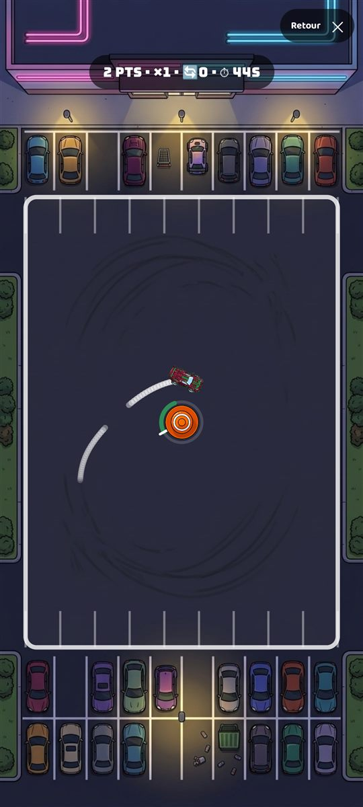 Le drift</td>
<td align="center">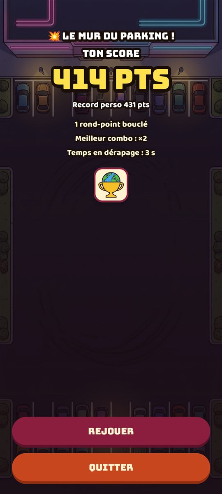 Résultats</td>
</tr>
</table>

## 🌐 Joue avec tes potes

- **En ligne, en temps réel** : duel contre un inconnu, ou salon privé avec tes amis (code, QR code
  ou lien d'invitation) pour Pile Poil, Réflexe de Beauf et Dans le Mille.
- **Classement mondial** et classement **ELO** des duels.
- **Coups fourrés** dans Dans le Mille : fumigène, miroir, stroboscope… pour déstabiliser l'adversaire.
- **À plusieurs sur le même téléphone**, chacun son tour, pour les soirées au camping.

## 🪙 Progression

<table>
<tr>
<td align="center">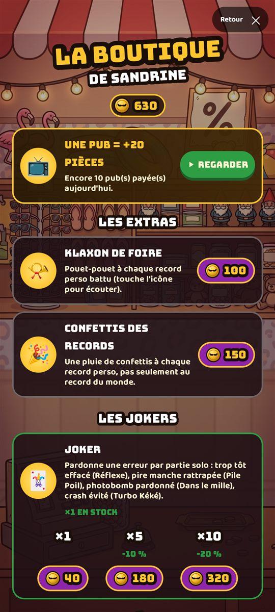 La boutique de Sandrine</td>
<td align="center">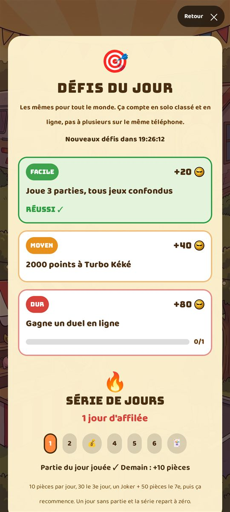 Les défis du jour</td>
<td align="center">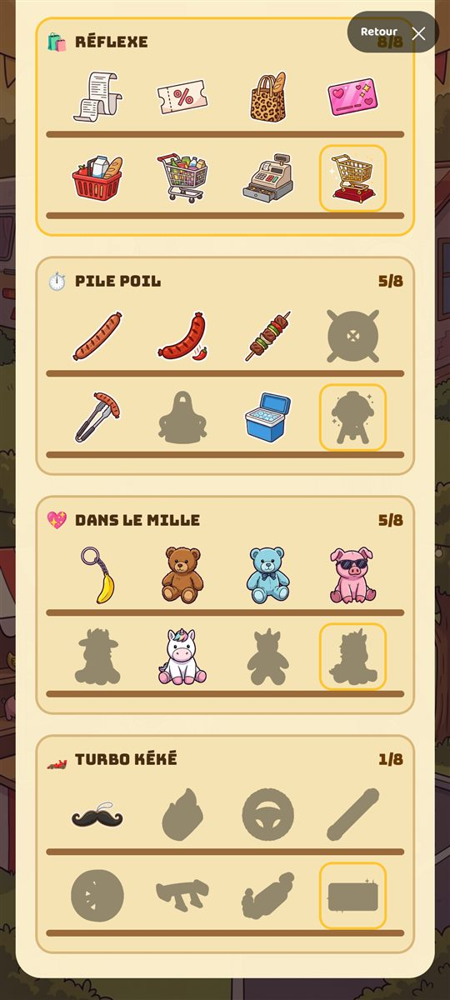 Ma vitrine</td>
</tr>
</table>

- **Cadeau de bienvenue** à déballer en arrivant.
- **Pièces** gagnées en jouant, à dépenser dans **la boutique de Sandrine** : extras pour fêter tes
  records, et **Jokers** pour pardonner une erreur.
- **Défis du jour**, les mêmes pour tout le monde, et une **série de jours** à entretenir.
- **Niveaux et titres**, de « Touriste » à « Légende de la Ligue ».
- **Succès et vitrine** : une étagère de lots kitsch à compléter pour chaque jeu.
- Un camping qui change de décor au fil des saisons et des évènements 🎃

Pas de pay-to-win : rien ne s'achète qui fausserait les classements.

## 👪 La famille Merguez

<table>
<tr>
<td align="center">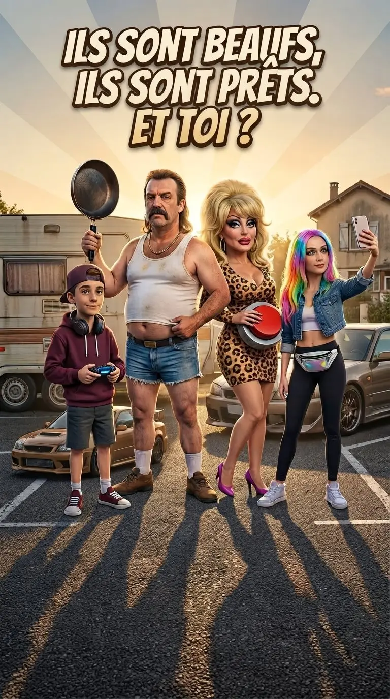 Ils sont beaufs, ils sont prêts. Et toi ?</td>
<td align="center">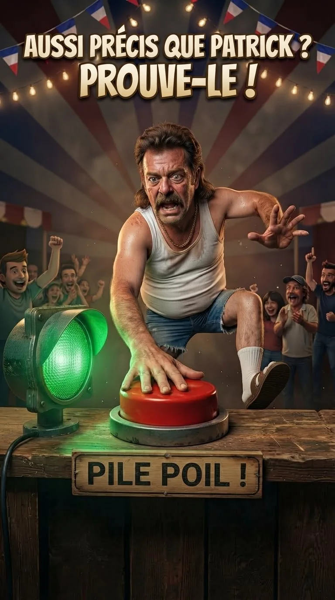 Patrick</td>
<td align="center">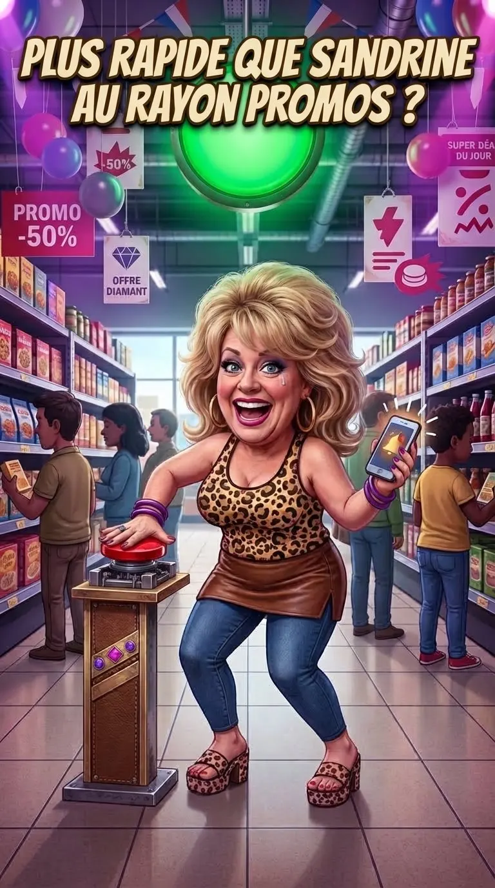 Sandrine</td>
</tr>
<tr>
<td align="center">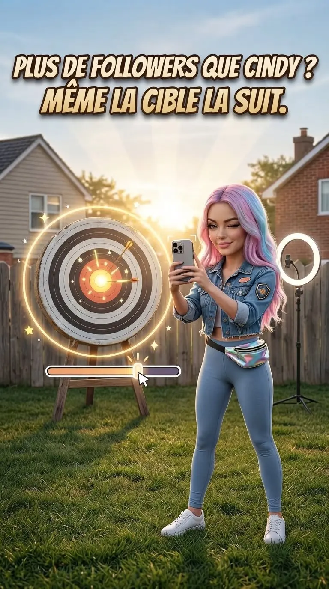 Cindy</td>
<td align="center">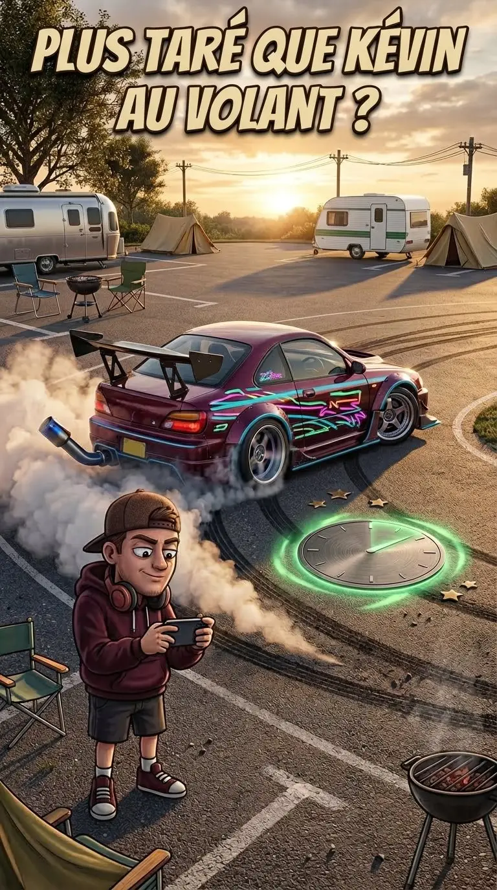 Kévin</td>
<td></td>
</tr>
</table>

- **Patrick**, le père : moustache, marcel, chaîne en or, roi du barbecue et de la pétanque. Il a
  toujours le timing parfait. Enfin, il le croit.
- **Sandrine**, la mère : brushing, créoles et léopard. Elle réagit au quart de tour à la moindre promo.
- **Cindy**, la fille : mèche colorée et sac banane. Elle vise le selfie parfait, le like parfait.
- **Kévin**, le fils : casquette à l'envers et manette à la main. Sa voiture téléguidée, c'est ce qui
  se rapproche le plus d'un permis pour l'instant.

## 📊 Où en est le projet

L'app est **en test sur le Google Play Store**, en route vers sa sortie publique. De nouveaux jeux et
de nouvelles surprises sont en préparation au camping… 🍹🧸

Ce dépôt est la vitrine du projet : le code source de l'application reste privé.

Fait en France avec Kotlin et Jetpack Compose · © La Ligue des Beaufs

